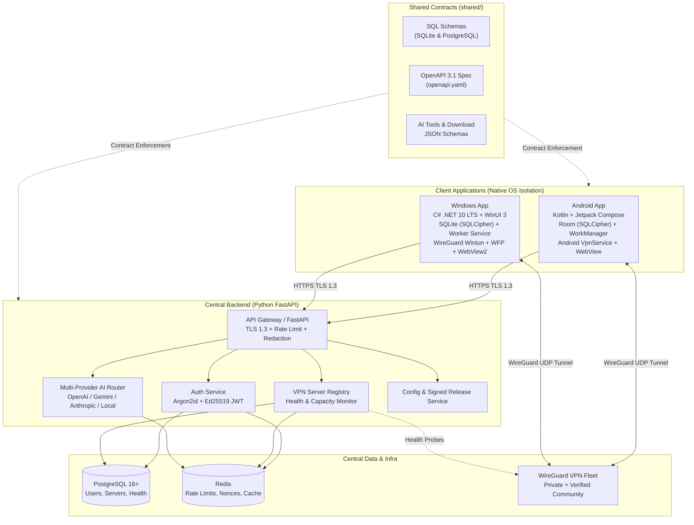
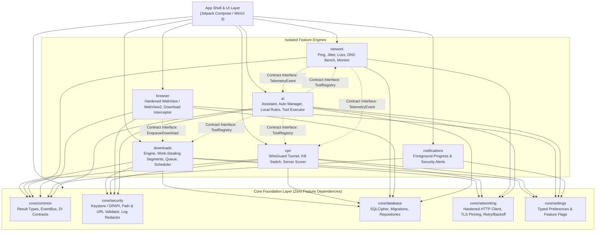

# RYN-AI-Speed v2.0 — Final Architecture Document (Phase P0)

**Version:** 2.0.0-P0  
**Status:** Ready for P0 Sign-off  
**Target Platforms:** Android (Kotlin + Jetpack Compose) & Windows (C# + .NET 10 LTS + WinUI 3)  
**Backend:** Python 3.12+ + FastAPI + PostgreSQL 16+ + Redis  

---

## 1. Repository Assessment (Greenfield P0 Audit)

Because `RYN-AI-Speed` is starting as a clean repository (greenfield initialization), this P0 assessment establishes strict structural guardrails before any platform code is written in P1:

- **Repository Identity:** `RYN-AI-Speed` (monorepo housing `android/`, `windows/`, `backend/`, `shared/`, `infrastructure/`, `tests/`, `docs/`, and `.github/`).
- **Zero Empty Scaffolding Rule:** In P0, only real, validated architectural documents, schemas, OpenAPI specs, and JSON contracts are created. Platform directories (`android/`, `windows/`, `backend/`) will be scaffolded and build-verified in **P1**.
- **Single Source of Truth (`shared/`):** Database contracts, REST API specifications (`openapi.yaml`), and AI tool JSON schemas live in `shared/` so Android, Windows, and Backend stay 100% synchronized without drift.

---

## 2. Hardened Architectural Upgrades (Improvements Over Baseline Plan)

To maximize **strength, security, performance, and zero-error reliability**, the following architectural upgrades have been adopted into the approved v2.0 design:

1. **Encrypted Local Persistence (SQLCipher AES-256):**
   - *Baseline:* Plain SQLite.
   - *Upgrade:* SQLCipher (`AES-256-CBC` / `HMAC-SHA512`) on both Android (`Room` + `sqlcipher-android`) and Windows (`Microsoft.Data.Sqlite` + `SQLitePCLRaw.bundle_e_sqlcipher`), with keys sealed in **Android Keystore (StrongBox/TEE)** and **Windows DPAPI/CNG**.
2. **Download Engine: Sparse Pre-Allocation + Dynamic Work-Stealing:**
   - *Baseline:* Static 4-part files merged at the end (requires 2x disk space, high merge I/O, tail-latency stall).
   - *Upgrade:* Pre-allocated single `.ryntmp` sparse file with direct offset writes (`FileChannel` / `RandomAccess.Write`), **Dynamic Work-Stealing** (fast workers split remaining chunks of slow workers), mandatory `ETag` + `If-Range` validation, and atomic rename on SHA-256 verification.
3. **VPN Engine: Zero-Knowledge On-Device Keys & OS-Level Kill Switch:**
   - *Baseline:* Generic WireGuard integration & software Kill Switch.
   - *Upgrade:* WireGuard private keys generated strictly on-device (never transmitted to Backend or AI). Kill Switch enforced at the OS network stack: **Android `VpnService` Lockdown + IPv6 Blackhole (`::/0`)** and **Windows Filtering Platform (WFP) persistent rules** that block non-tunnel traffic even if the app crashes.
4. **Backend Auth: Argon2id + Ed25519 JWT + Refresh Token Reuse Detection:**
   - *Baseline:* Generic short-lived access tokens + refresh rotation.
   - *Upgrade:* Password hashing via **Argon2id**, asymmetric **EdDSA (`Ed25519`)** JWT signing (15-min TTL), and hashed opaque refresh tokens with **token-family reuse detection** (instant family revocation on replay).
5. **AI Safety: Strict JSON Schema Registry + Prompt-Injection Isolation:**
   - *Baseline:* 12 tool names with general permission levels.
   - *Upgrade:* Machine-readable JSON Schema (`shared/contracts/ai_tools_schema.json`) with `additionalProperties: false`, 3-tier RBAC (`READ`, `SAFE_ACTION`, `PROTECTED_ACTION` requiring an explicit signed UI confirmation token), and deterministic local rules engine fallback when offline.

---

## 3. High-Level System Architecture

---

## 4. Module Dependency Diagram (Fault-Isolated Client Core)

**Fundamental Rule:** Feature modules (`downloads`, `vpn`, `network`, `browser`, `ai`) NEVER directly depend on each other's concrete implementations. All cross-module communication flows through **strict interfaces and an in-process Event Bus** in `core/`. A crash or exception inside one engine is trapped at the module boundary and emits a degraded-state event without crashing the app.

---

## 5. Code-Sharing & Platform Parity Matrix

- **Shared Across All Platforms (Contract Level):**
  - Database schema semantics (`downloads`, `download_segments`, `vpn_servers`, `network_tests`, `ai_*`, `browser_*`).
  - REST API contracts (`shared/api-spec/openapi.yaml`).
  - AI Tool JSON Schemas & permission rules (`shared/contracts/ai_tools_schema.json`).
  - Download state machine transitions (`shared/contracts/download_contract.json`).
- **Platform-Native (Never Forced Into Shared Abstractions):**
  - **Android:** Kotlin, Jetpack Compose, Coroutines/Flow, Hilt DI, Room + SQLCipher, WorkManager + ForegroundService, Android `VpnService` + `wireguard-android`, `Android WebView`, Storage Access Framework (SAF).
  - **Windows:** C#, `.NET 10 LTS`, WinUI 3, `Microsoft.Extensions.DependencyInjection`, `Microsoft.Data.Sqlite` + SQLCipher, Windows Background Service, WireGuard Wintun + Windows Filtering Platform (WFP), `Microsoft WebView2`.

---

## 6. Architectural Decision Records (ADRs)

- **ADR-001 (Native Dual-Stack over Cross-Platform UI):** Native Kotlin/Compose and C#/WinUI 3 are chosen over Flutter/Electron because OS-level VPN (`VpnService`, `Wintun` + `WFP`), background download survival, and native `WebView2` integration require direct platform APIs with minimal RAM overhead.
- **ADR-002 (Sparse Pre-Allocation over Multi-Part File Merge):** Direct offset writes into a single `.ryntmp` file eliminate the 2x storage requirement and post-download merge pause on large files (1 GB – 50 GB+).
- **ADR-003 (Local-First Privacy):** Browsing history, bookmarks, downloaded files, and local AI session memory remain strictly on-device by default and are never uploaded to the Backend.
- **ADR-004 (Offline Resilience):** If the Backend is unreachable, the Download Engine, Built-in Browser, Network Optimizer, Local AI Rules Engine, and cached WireGuard server profiles continue functioning seamlessly.
